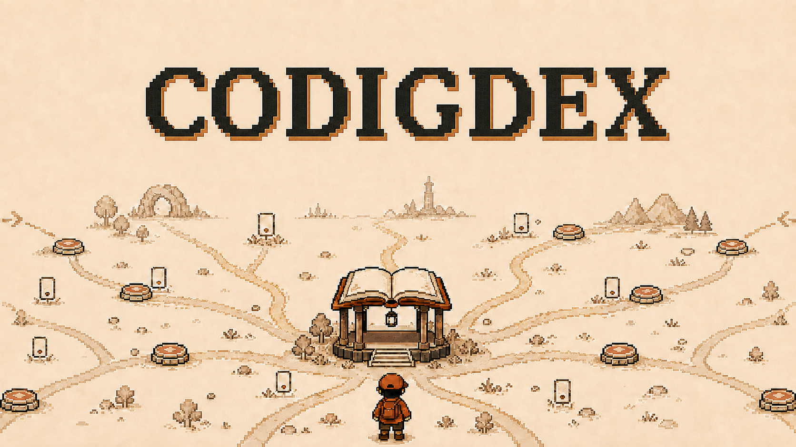
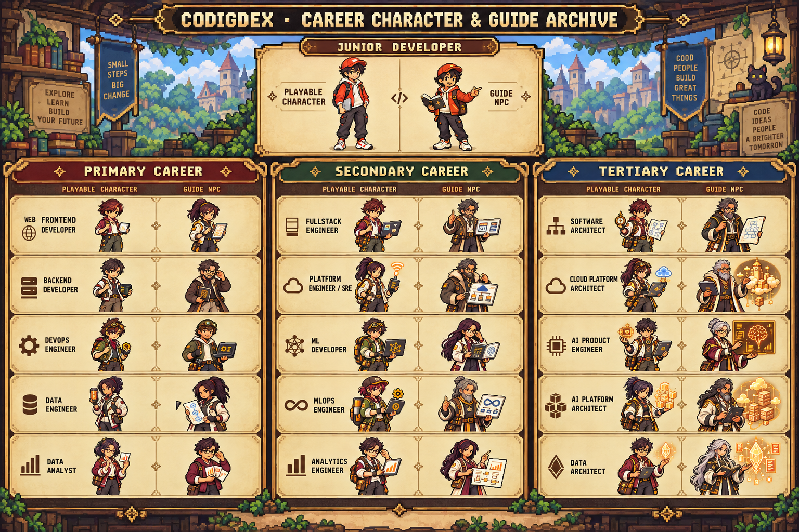
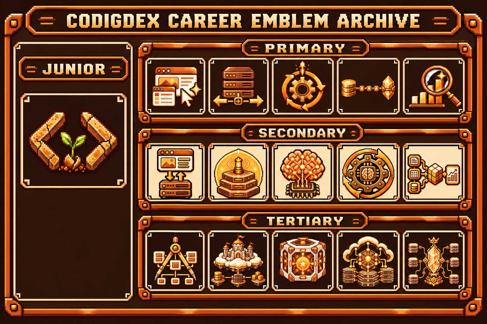

<!-- markdownlint-disable MD033 MD041 -->
<p align="center">
  
</p>

<h1 align="center">Codigdex</h1>

<p align="center">A pixel-art learning game where you defeat bug monsters and complete your own coding dex</p>
<p align="center"><a href="README.md">한국어</a> · <b>English</b></p>
<!-- markdownlint-enable MD033 MD041 -->

[](https://github.com/codingnanyong/codigdex/actions/workflows/ci.yml)
[](https://github.com/codingnanyong/codigdex/actions/workflows/pr-policy.yml)
[](https://github.com/codingnanyong/codigdex/actions/workflows/claude-review.yml)
[](https://codigdex.vercel.app)
[](LICENSE)

## What is Codigdex?

In **Codeville**, a pixel village on a server cloud, the concepts hidden in code roam around as bug monsters. Step in as a junior developer on your very first adventure, face the monsters, prove you really understand each concept, and fill your own dex: **Codigdex**.

Instead of reading and moving on, you learn to code by catching concepts one at a time.



## How to play

1. **Take a request** — a guide NPC tells you which bug monster has appeared in the area.
2. **Question battle** — attack by answering the coding questions the monster throws at you. Every right answer weakens it.
3. **Register it** — get 60% or more right to capture the monster and keep its card in your dex. Failing costs nothing, and a retry brings new questions.
4. **Move on** — each capture brings a stronger monster, and finishing a chapter opens a new region.

## Your adventure

```text
Tutorial · Loop Forest
  → CH.01 Git · Field of Records
  → CH.02 Linux · Shell Cave
  → Tier 1 promotion: Web Frontend · Backend · DevOps · Data Engineer · Data Analyst
  → Tier 2 promotion: hybrid careers that bridge two fields
  → Tier 3 promotion: master careers (names and emblems only; gameplay is locked)
```

First learn Git and Linux, the skills every developer needs, then pick a career and explore that career's own map. Each career has a senior NPC to guide you, and higher careers like Fullstack Engineer or ML Developer stay hidden behind `???`, waiting for you to walk both paths that lead to them.



## Things to collect

- **Monster dex** — 174 entries, from the Loop Bug to the Git Sprout, the Kernel Guardian and open-source tool cards. Git, Linux and the career specialist chapters have monsters that evolve from Lv.1 to Lv.5. Monsters you have not captured yet stay as `???`.
- **Career dex** — collect 16 career emblems, from junior developer to tier 3 master careers. The day you first promoted and the day you mastered each career are recorded. Tier 3 careers can be revealed, but you cannot promote into or play them yet.



## Playable now

- Collect 11 monsters across the common tutorial, Git and Linux chapters
- Promote into one of 5 tier 1 careers and battle through its specialist chapters (HTML/CSS, Docker, SQL and more)
- Promotion chapters for 5 tier 2 careers: 5 missions each, 25 stages in all, with 500 questions in Korean and English
- Career surprise requests: optional requests that appear after career battle wins, covering 38 open-source tools and 266 questions
- Open-source notes: review the tools you discovered through surprise requests. There is no separate open-source expedition entrance
- Monster dex with 174 entries and career dex with 16
- Switch between Korean and English in settings

Your progress is saved automatically: in the browser on the web, and on the device in the mobile app. Surprise request and discovery history stays with each browser or device, while captured cards are stored in the regular save.

👉 **[Play now at codigdex.vercel.app](https://codigdex.vercel.app)**

## Platforms and verification

The mobile app has not been released through a store or EAS, so for now you play on the web or build the app yourself. Simulator acceptance finished on 2026-10-29, after first runs on commit `ddc1e73` and an iOS retest.

| Platform | Device | Full native scenario run |
| --- | --- | --- |
| Android | Pixel 8 · API 36 | 28/28 passed |
| iOS | iPhone 18 Pro · iOS 27.0 | 27/28 passed on the first run; the failed Analytics promotion path then passed in full on a retest that centers the button before tapping |

The 28 native automated scenarios are separate from the 17 starting states you pick by hand on the QA screen. Details are in the [acceptance record](qa/home/native-simulator-acceptance.json) and the [handoff report](qa/home/native-simulator-acceptance-handoff.txt).

Still open:

- New IME and accessibility acceptance on physical devices
- Real DB, OAuth and cloud save round-trip acceptance
- COD-258 (local save attribution and merge) and COD-259 (online/offline sync): postponed until the environment is designed
- Tier 3 career gameplay: locked

## Run locally

The web app is built with Next.js, Phaser and TypeScript; the mobile app with Expo and React Native.

```bash
npm install
npm run dev --workspace @codigdex/web
```

Open [http://localhost:3001](http://localhost:3001) in your browser. Run the tests with `npm run test`.

For the mobile app, set up an Android emulator and run `npm run mobile:qa:android`, or set up an iOS simulator (requires macOS and Xcode) and run `npm run mobile:qa:ios`.

## Agent workspace

Two agents work this repository — Claude and Codex — and they share one configuration tree. Eight folders at the repository root are the **only** source of truth for agent config:

| Folder | Holds |
| --- | --- |
| `agents/` | Subagent definitions |
| `commands/` | Slash commands |
| `hooks/` | Hook scripts |
| `output-styles/` | Output styles |
| `plugins/` | Plugin registry |
| `rules/` | Short always-on rules |
| `skills/` | Skills (one `SKILL.md` per folder) |
| `templates/` | Document templates |

Every entry inside those folders starts with `shared-` (both agents), `claude-` (Claude only), or `codex-` (Codex only).

`npm run setup:agents` (also wired as `postinstall`, so `npm install` alone runs it) creates **directory links** — symlinks on POSIX, junctions on Windows — under `.claude/`, `.codex/`, and `.agents/` pointing from each tool's expected location to the matching root folder. All of those link paths are git-ignored, so the root folders remain the only source of truth. Never edit or commit files through a link path; change the root folder instead.

`.claude/settings.json` is the **only** tracked Claude-specific safety config (permission denials plus the protected-path hook and status-line registrations). `CLAUDE.md` merely imports `@AGENTS.md`, so rules belong in [AGENTS.md](AGENTS.md).

After changing any of this, run `npm run check:agents` to verify the links, required files, prefixes, and hook behavior — CI runs the same command. At handoff, write the report using [templates/shared-handoff.md](templates/shared-handoff.md). Full rules live under "Agent workspace layout" in [AGENTS.md](AGENTS.md).

## Docs

- [Game Design Document](docs/eng/GAME_DESIGN.md) — game rules, screens, visual guide
- [Career Path Design](docs/eng/CAREER_PATH_DESIGN.md) — curriculum, promotion requirements, save format
- [Git workflow](docs/eng/GIT_WORKFLOW.md) — branch strategy, PR and issue automation
- [Monorepo architecture](docs/eng/MONOREPO_ARCHITECTURE.md) — web/mobile apps and shared package boundaries
- [Account linking and cloud saves](docs/eng/ACCOUNT_LINKING_AND_CLOUD_SAVE.md) — Google, GitHub, and Apple identities plus cross-platform save ownership
- [Contributing](CONTRIBUTING.md) · [Project and PR policy](AGENTS.md)

## Contributing

This project is built and reviewed by one person, so outside pull requests are not accepted. If you spot a bug or an incorrect explanation, please let me know with an Issue. See the [contributing guide](CONTRIBUTING.md) for details.

## License

[MIT](LICENSE) © codingnanyong
