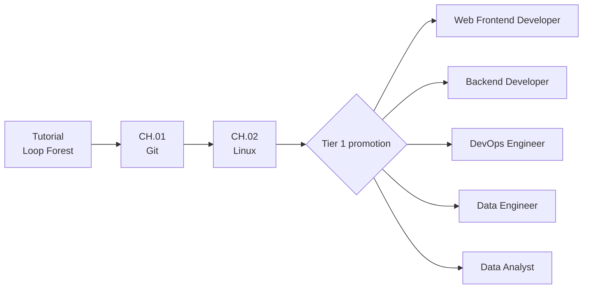
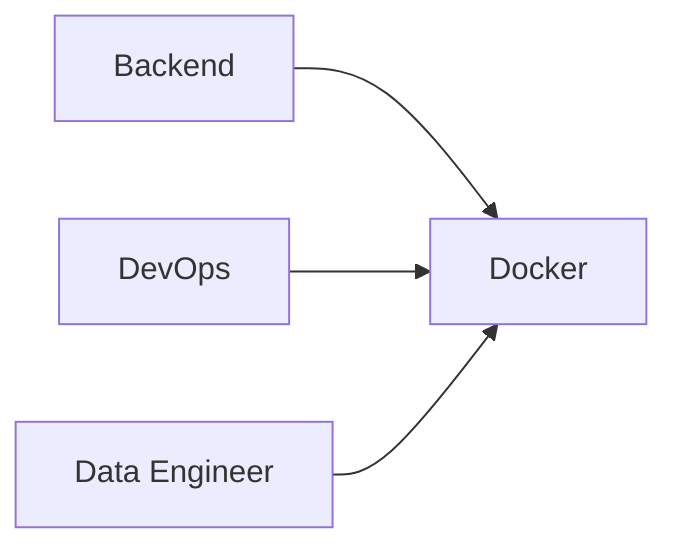

# Codigdex Career Path Design

[한국어](../kor/CAREER_PATH_DESIGN.md) · **English**

The Codigdex learning journey runs **tutorial → junior common path → tier 1 promotion → career specialist courses → tier 2 and tier 3 promotion**. This document is the reference for expanding game content, and also the source material for blog posts introducing the developer learning roadmap.

> Last updated: 2026-11-02. Each section describes the current implementation, and parts without content yet are marked **(planned)**. Game-wide rules follow the [Game Design Document](GAME_DESIGN.md). The game supports Korean and English; English names here match the English UI, with the Korean original in parentheses where it helps.

## Overall structure



The tutorial is not a regular chapter. It uses loop questions to let the player experience the core loop first: request, question battle, dex entry. The regular curriculum starts at `CH.01 Git`.

## Junior common path

| Order | Course | Region | Why everyone learns it |
| --- | --- | --- | --- |
| CH.01 | Git | Field of Records (기록의 들판) | Tracking changes, collaborating and recovering are baseline skills for every developer role. |
| CH.02 | Linux | Shell Cave (셸 동굴) | Understanding files, paths, permissions, processes and running commands lets players handle later dev tools on their own. |
| Promotion | Pick a tier 1 career | Career lineage screen | With a minimal shared foundation in place, the player enters the specialist course they care about. |

The common path stays short. If every technology became a promotion requirement, players could burn out before ever reaching the role they are interested in.

### Stages inside a chapter

Each common-path chapter is not a single monster but **five stages, Lv.1 to Lv.5**. On the world map, Lv.1–Lv.4 circle the region and Lv.5 sits in the center as the mastery encounter. After capturing a stage, the field player walks along the terrain-following route to the next stage's checkpoint.

- Capturing a stage opens the next one; capturing the last stage opens the next chapter.
- Every stage has one dex slot and 20 topic questions.
- A battle draws level + 2 questions (Lv.1 asks 3 → Lv.5 asks 7).
- Answering at least 60% of the drawn questions (rounded up) captures the monster (Lv.1 2/3 · Lv.2 3/4 · Lv.3 3/5 · Lv.4 4/6 · Lv.5 5/7).
- The battle ends the moment the target is reached or becomes unreachable.

Requiring every answer to be correct is not used: for beginners a single mistake would mean failure, which is far too harsh.

| Chapter | Lv.1 | Lv.2 | Lv.3 | Lv.4 | Lv.5 |
| --- | --- | --- | --- | --- | --- |
| CH.01 Git (`001–005`) | Git Sprout (깃새싹) · repository basics | Branch Twins (브랜치 쌍둥이) · branch and merge | Conflict Rewinder (충돌 되돌이) · conflicts and undoing | Remote Rebaser (원격 리베이서) · remotes and rebase | Workflow Guardian (워크플로 수호자) · PR, review, CI |
| CH.02 Linux (`006–010`) | Shell Scout (셸 탐험가) · shell basics | Path Forager (경로 채집가) · paths and files | Permission Guard (권한 수호병) · permissions and users | Pipe Engineer (파이프 엔지니어) · pipes and processes | Kernel Guardian (커널 수호자) · kernel and boot |

Chapter specimens (`git-specimen`, `linux-specimen`) are the chapter icons on the Path map; battles use the per-stage monsters.

### Entering tier 1 promotion

The first capture of CH.02 Lv.5 shows a "Common path complete!" notice on the result panel, and confirming it goes to the career lineage screen instead of the world map. A save that finished the common path but has not picked a career yet is also sent to the promotion screen on its next visit. Before a promotion is confirmed, a dialog shows the player's career character and the guide NPC side by side.

## Why Docker is not on the common path

Docker is important, but it is not a fundamental that every beginner role needs at the same time and depth. Containers are learned best once the player understands the terminal, processes, networking and running servers.

So Docker is designed as a **shared specialist region** that several careers meet again after promotion.



Frontend developers and data analysts can still learn Docker optionally, but it is never a requirement that blocks promotion.

## Career detail maps

After promotion, each career's v3 wallpaper detail map lays out its technology regions in order. That order is the recommended learning order.

| Career | Guide NPC | Technology regions (map order) | Count |
| --- | --- | --- | ---: |
| Web Frontend Developer | UI Alchemist Mina (UI 연금술사 미나) | HTML/CSS → JavaScript → Browser · HTTP → React → Frontend testing | 5 |
| Backend Developer | Server Guardian Taeo (서버 수호자 태오) | HTTP/API → Server framework → Database · SQL → Auth · Security → Networking → Docker | 6 |
| DevOps Engineer | Automation Artisan Doyun (자동화 장인 도윤) | Networking → Docker → CI/CD → Kubernetes → Cloud · IaC → Monitoring | 6 |
| Data Engineer | Pipeline Architect Hana (파이프라인 설계자 하나) | Python → SQL · Data modeling → Data pipelines → Docker → Orchestration → Monitoring | 6 |
| Data Analyst | Insight Detective Ian (인사이트 탐정 이안) | SQL → Basic statistics → Data visualization → BI tools → Python for analysis | 5 |

Regions are defined in `packages/game-content/src/domain/careerPaths.ts`. All 28 technology regions are playable. Each region has five ordered monsters, and each monster has a bilingual 10-question pool.

### Map depth and navigation

The Path screen and the play regions are different screens. The Path map is a roadmap showing the common path and promotion relationships; picking a tier 1 career turns the world map into that career's **detail map**. Tapping an available technology region on the detail map opens a zoomed-in **technology region screen**, where five monster checkpoints lead into the standard battle and capture flow.

```text
Path map → career detail map → technology region → battle/capture
```

Each career wallpaper already paints the routes and landmarks. Instead of numbered discs, the UI adds invisible hit areas fitted to each building's or island's real outline, plus an `order · technology` label. Hovering a region lifts only a transparent texture cut from the wallpaper along that region's outline (`<career>-<region>-terrain-v3.png`), adds a shadow beneath it, and shows the region name in the middle of the map. The hit area (`focusPoints`) is deliberately generous, while the lifted silhouette (`lift`) is defined separately to hug the building's outline. No rectangle or polygon outline is drawn, and the wallpaper itself never moves. The bottom of the map shows the guide NPC, the current career's field character (`MY PLAYER`), and the tier 2 `◆ ???` slot.

So adding a new chapter does not mean redrawing the Path map: add the destination's focus area to the detail map data, then connect that destination to the chapter region.

The maps above describe the web client. The mobile client shows the same regions, checkpoints and gates on native world and career screens.

### Characters and guide NPCs

Bug researcher Lupi (루피) guides the common path before promotion. After promotion, each career's senior NPC takes over on the detail map and appears as a half-body portrait at the bottom of the dialog. Changing careers swaps the map and NPC immediately along with the saved tier 1 career.

| Asset | Path | Used for |
| --- | --- | --- |
| Career full-body character | `assets/characters/career-path/<career-id>/player-v2.png` | Career lineage list, promotion confirmation dialog |
| Guide NPC | `assets/characters/career-path/<career-id>/guide-v1.png` | Dialog portrait |
| Field player (junior) | `assets/characters/player/overworld-player-v1.png` | Walking common-path chapter routes |
| Field player (tier 1 career) | `assets/characters/career-path/<career-id>/overworld-v1.png` | Walking the world map after promotion, detail map `MY PLAYER` |
| Character sheet | `assets/characters/career-path/career-character-guide-v2.png` | Archive of players and guides from junior to tier 3 |
| Career emblem | `assets/career-emblems/<career-id>-v1.png` | Career dex (16 emblems) |

## Technologies shared between careers

Career paths are not five fully separate lines. They form a crossing tree where different careers meet the same technology in different contexts. The table below lists the shared regions actually placed on today's detail maps.

| Shared technology | Careers whose maps include it |
| --- | --- |
| HTTP · API | Web Frontend, Backend |
| SQL · Databases | Backend, Data Engineer, Data Analyst |
| Python | Data Engineer, Data Analyst |
| Docker | Backend, DevOps, Data Engineer |
| Networking | Backend, DevOps |
| Monitoring | DevOps, Data Engineer |

The `paths` field in the technology specimen definitions (`packages/game-content/src/domain/technologySpecimens.ts`) records wider links than this. For example, testing and CI/CD are linked to Frontend, Backend and DevOps, and Cloud · IaC and Kubernetes to Backend, DevOps and Data Engineer. Use that list as the reference when adding regions to a map.

Captures go into one dex regardless of career, so a player who captured a shared technology first keeps that card after promoting into another career. This avoids forcing players to relearn and gives them a reason to explore other roles.

## Changing tier 1 careers

- As a junior, the player can pick any of the five tier 1 careers.
- Once a tier 1 career is picked, the player cannot switch to another tier 1 career until that career's path is complete (MASTER). Other careers show as `locked` on the lineage screen, and tapping one explains that the current career's chapters must all be completed first.
- Path completion is computed by checking that every capture in the career's `completionCaptureIds` is in the dex. An empty list never counts as complete.
- Each tier 1 career derives `completionCaptureIds` from **every checkpoint** in its released regions, not only each region's final stage. Completing all of them records that career as MASTER and allows the player to select another tier 1 path.
- An earned tier 2 career is kept while the player studies a tier 1 path. While it is equipped and unfinished, completed tier 1 paths can be replayed, but an unfinished tier 1 path cannot be started. After tier 2 mastery, the next tier 1 study can begin and stays binding until that path is complete.
- The rules live in `packages/game-content/src/domain/gameProgress.ts` and are shared by web and mobile.

> Release status (2026-11-02 KST): the full-checkpoint mastery rule and earned tier 2 preservation are merged into `develop` (PR #141) and into `main` through release PR #142 (merge commit `eeddbd03ecc3757359c3a2073c9758c98264df6d`). CI and the Claude and Codex reviews passed, and the Vercel status is success. The production smoke check against `https://codigdex.vercel.app` passed all 12 cases on 2026-11-02: boot and assets, save and language restoration, and 10 progression regressions across the 5 tier 2 careers. Mobile has no published build.

## Tier 2 promotion (hybrid careers)

Completing two tier 1 career paths opens a tier 2 career that bridges both fields. Together with the rule that shared cards are kept, this gives a player who finished one career a reason to explore another. All five integration chapters are playable: 5 chapters, 25 stages and 500 bilingual questions (20 per stage). Stages open in order and use the same battle and capture rules as other chapters.

The career lineage screen shows four columns from left to right: **pre-promotion junior developer → tier 1 → tier 2 → tier 3**. Lines branch from the junior card to every tier 1 career, and each tier 1 career connects to the tier 2 careers it can combine into. The name and selection of a tier 2 career are revealed only when the set of tier 1 careers with a MASTER record covers that career's `requires` pair. For example, completing Frontend and Backend opens Fullstack Engineer, but Platform Engineer / SRE stays locked until DevOps is also complete. Each tier 2 career links horizontally to exactly one tier 3 career so the full lineage never tangles.

| Tier 2 career | Guide NPC | Unlock requirement | Integration chapter | Stage topics (Lv.1–Lv.5) |
| --- | --- | --- | --- | --- |
| Fullstack Engineer | Boundary Architect Ara (경계의 설계자 아라) | Web Frontend + Backend | CH.24 The Linked Villages | API contracts · request state · transactions · tracing · integration checks and recovery |
| Platform Engineer / SRE | Platform Navigator Jun (플랫폼 항해사 준) | Backend + DevOps | CH.23 Harbor of Reliability | Release paths · observability · SLOs and error budgets · incident mitigation · recovery verification |
| ML Developer | Model Tamer Yujin (모델 조련사 유진) | Backend + Data Engineer | CH.25 The Prediction Greenhouse | Samples and data quality · feature parity · leakage-free evaluation · inference contracts · model-service verification |
| MLOps Engineer | Model Operator Siwoo (모델 운영관 시우) | DevOps + Data Engineer | CH.26 The Cycle Nursery | Data and model lineage · reproducible training · model promotion · drift detection · safe retraining |
| Analytics Engineer | Metrics Translator Sora (지표 번역가 소라) | Data Engineer + Data Analyst | CH.27 The Metrics Observatory | Table grain · data tests and freshness · metric definitions · change impact · trusted delivery |

- **Only combinations with a real job title exist.** Building all 10 combinations of five tier 1 careers would add content while blurring what each career means.
- **Reveal like a dex silhouette.** The lineage screen and detail map show only a `◆ ???` slot. The detail map slot only says the identity is revealed after completing another tier 1 career path, while the lineage and Path map slots state the requirement, e.g. "Opens after completing both `<Career A> + <Career B>` paths." Hiding them entirely would leave players unaware they exist, with no motivation to reach them.
- **Uncaptured monsters hold a dex slot.** They show only a number and `???`, and they do not count toward the dex's registered total or completion. The dex has 199 entries, including tier 2 stages, 38 open-source tool cards and 25 final-project guardians.
- **Not just a title.** Each tier 2 career comes with a five-stage integration chapter bridging both fields, its own guide NPC and a career emblem.
- **Unlocks are recomputed from captures.** Tier 1 and tier 2 mastery are derived from released captures each time a save is normalized, not trusted from stored flags. Unearned mastery or unlock records are removed, while captures and records for unknown content are preserved.

## Tier 3 promotion (master careers)

Tier 3 does not require another career combination. Completing every stage of a tier 2 chapter (`masteryCaptureIds`) records that career as MASTER and reveals the matching tier 3 career's name and emblem. The lineage screen attaches exactly one tier 3 career beside each tier 2 career, so the connecting lines stay simple.

The source now implements five playable final design projects (CH.28–32), one per tier 3 career. Each project has five milestones. Each milestone provides a worked example and rationale, three new required design questions and seven related tier 2 review questions. Every draw includes all three required questions; all must be correct and the normal 60% score also applies. Completing five milestones records the final project; explicit confirmation then equips tier 3. This implementation is pending publication and deployment. The earlier production acceptance does not certify this change.

Entry requires the matching tier 2 MASTER and all 20 regional practice checkpoints. The 25 tier 2 regions now have worked examples, official references and four five-question practice decks. Passing 3 of 5 saves a checkpoint; failure adds no completion. New guardian battles require all four regional checkpoints. Existing captures and earned tier 2 mastery remain; legacy players must finish the added practice before entering a final project. There are 100 practice checkpoints and 25 new project guardians, taking the dex to 199 entries.

| Tier 2 career | Tier 3 career | Guide NPC |
| --- | --- | --- |
| Fullstack Engineer | Software Architect | System Sage Rohan (시스템 대현자 로한) |
| Platform Engineer / SRE | Cloud Platform Architect | Cloud Citadel Architect Haneul (구름 성채 설계자 하늘) |
| ML Developer | AI Product Engineer | AI Workshop Master Jian (AI 공방장 지안) |
| MLOps Engineer | AI Platform Architect | Intelligence Foundation Architect Leon (지능 기반 설계자 레온) |
| Analytics Engineer | Data Architect | Data Archivist Seoyun (데이터 기록관 서윤) |

## Career dex

The `Career` tab in Codigdex collects all 16 careers from junior to tier 3, numbered from `JOB.000`. Each record holds these timestamps:

| Field | Recorded when |
| --- | --- |
| `unlockedAt` | The career unlocks. Junior from the start, tier 1 careers when the common path is complete, tier 2 when both tier 1 careers reach MASTER, tier 3 when the matching tier 2 career reaches MASTER |
| `selectedAt` | The player first promotes into that career. Tier 3 requires a completed final project and explicit confirmation |
| `masteredAt` | The player completes that career's path. For junior, when the common path is complete |

The screen shows locked · available · current · MASTER states and a `registered n/16 · MASTER m` summary. A career change does not clear a previous career's first-promotion and MASTER history. A MASTER timestamp is kept only while the captures still earn it.

## Career surprise requests and discovery notes

After a career or promotion battle win, the game may offer an optional request that introduces an open-source tool through the player's current role. Web and mobile share these rules. The catalog has 38 tools with 7 bilingual questions each, 266 in all.

- **Who gets one:** the equipped tier 2 career decides the request; otherwise the tier 1 career does. Common-path battles and request battles do not trigger one.
- **When:** the first qualifying win in each career makes an offer. After that, no offer comes before 3 wins since the last one, each later win has a 25% chance, and the 6th win always offers while uncaptured tools remain for that career. Only one request can be pending.
- **Choice:** the player can accept or choose later. Later returns to the normal path, and an offered tool counts as discovered even if it is declined. A failed request battle can be retried, and the normal career checkpoint is kept.
- **Progress:** tool cards go into the regular dex, but they are never MASTER requirements.
- **Notes:** the discovery notes review tools the player has already discovered, and relevant discovered tools link from career screens. **There is no independent expedition entrance.** Old expedition bookmarks return to the career path, and tool cards captured before this change stay in the save.

## Save format

The save is a single slot, `codigdex:save:v3`, held in `localStorage` on the web and AsyncStorage on mobile. Instead of piling frequently changing screen state into one flat object, it is split into `progress`, `player` and `ui`. The platform-neutral schema and migrations are in `packages/game-core/src/save/schema.ts`.

```ts
{
  version: 3,
  progress: {
    captures: [{ id, capturedAt }],                            // monster captures
    careers: [{ id, unlockedAt, selectedAt?, masteredAt? }],   // career dex history
    projects: [{ id, completedAt }],                         // optional in older v3 saves
  },
  player: { primaryJobId, secondaryJobId, tertiaryJobId },    // currently selected careers
  ui: { tutorialOnboardingSeen, locale?, checkpointId? },      // screen state, language, last checkpoint
}
```

- `progress.captures` stores only the monster ID and capture time. Card display data is rebuilt from the current catalog definitions.
- `progress.careers` stores each career's unlock, first-selection and MASTER times. Normalization recalculates earned milestones from the current captures and selected careers, keeps valid earlier timestamps, and removes records the captures do not support.
- `progress.projects` stores `workshop:<stage>:<phase>` checkpoints and `project:<career>:v1` completion. Older v3 saves without it have no practice/project completion. Parsing, creation, Web snapshots, native writes and merge preserve this contract, including unknown IDs. Starting a new game clears all project progress. A completion flag alone cannot bypass captures and practice. If all prerequisites, practice and project captures exist but the final record is missing after an interrupted write, both normalizers restore it using the last valid project capture time. Recovery never equips tier 3 automatically.
- `player` stores selected careers. Tier 1 defaults to `junior`; earned tier 2 and tier 3 identities survive primary study and reconfirming the same secondary career. Switching secondary careers clears the equipped tertiary identity while earned history remains. Incomplete or ineligible projects cannot equip tier 3.
- `ui.locale` stores the language picked in settings (`ko` or `en`). It survives a new game; without it the web game starts in the browser's language and the mobile game in Korean.
- `ui.checkpointId` stores the last playable checkpoint. Old `open-source:` values are cleared so a player returns to the career path.
- Older `codigdex:save:v1` (flat layout) and `codigdex:save:v2` (no `careers`) saves are converted to v3 on first load, rebuilding career dex history from the selected careers. The old slots are kept as a migration safety net. Starting a new game on the web clears all three slots, while the mobile reset writes an empty save to the v3 slot.
- Surprise request and discovery history is stored separately under `codigdex:source-events:v1:<first tutorial capture time>`, so it stays with each browser or device and does not travel with the save. Captured tool cards are regular `progress.captures` entries.
- On mobile, a failed save or history read blocks startup with a retry instead of being treated as empty data. Failed writes show a retry prompt, and QA runs use separate key namespaces. See [`mobile/README.md`](../../mobile/README.md#save-persistence).

## Technology creature design guidelines

This compares the current detail map regions against the prepared representative technology creatures. A shared creature that exists on another map does not count as ready unless it matches the region's topic.

| Tier 1 career | Current technology regions | Matching creatures | Still needed |
| --- | ---: | ---: | --- |
| Web Frontend Developer | 5 | 5 | None |
| Backend Developer | 6 | 6 | None |
| DevOps Engineer | 6 | 6 | None |
| Data Engineer | 6 | 6 | None |
| Data Analyst | 5 | 5 | None |

All 28 current technology regions have a matching creature. There are 22 technology creatures (2 common + 20 specialist), and each chapter folder from `packages/game-assets/files/monsters/ch01.git/` to `ch22.bi-tools/` holds a specimen, a Lv.1–Lv.5 evolution set and an evolution sheet. `packages/game-assets/files/monsters/all-monster-evolution-guide-v1.png` shows the full set at a glance. The tutorial's Loop Bug (`ch00.tutorial`) is a single-stage creature that does not evolve, so its remaining cells are marked `N/A`. `web/test/domain/assets.test.ts` checks that every folder has its specimen and full evolution set.

Instead of stamping a technology's name on like a logo, each technology's core idea becomes a creature silhouette that is easy to remember in the dex. The Git creature from the original blog is the visual anchor, and its shared language is bold dark outlines, warm cream, Git-orange accents and small white eyes.

| Folder | Technology | Creature archetype | Concepts to remember |
| --- | --- | --- | --- |
| ch01 | Git | An orange creature growing branches and nodes | Branches, commits, merging |
| ch02 | Linux | A penguin explorer wearing a command panel | Shell, running commands, operating system |
| ch03 | HTML/CSS | An armadillo assembling bricks and color swatches | Structure, style, layout |
| ch04 | JavaScript | A firefly fox with current running through its code tail | Behavior, events, state changes |
| ch05 | HTTP/API | A two-headed messenger bird trading request letters | Requests, responses, interfaces |
| ch06 | Python | A scholar snake studying scrolls | Automation, data processing, general-purpose syntax |
| ch07 | SQL | An archivist mole carrying table drawers | Queries, relations, organizing data |
| ch08 | Networking | A cable crab linking three signal nodes | Connections, addresses, packets |
| ch09 | Testing | A detective beetle tracking bug traces | Verification, regression prevention, reliability |
| ch10 | Security · Auth | A pangolin guardian with a key tail and layered armor | Identity, permissions, protection |
| ch11 | Docker | A whale carrying three containers | Images, containers, isolation |
| ch12 | CI/CD | A relay runner with status lights and looping arms | Automation, pipelines, feedback |
| ch13 | Kubernetes | A cluster helmsman directing three Pods | Scheduling, coordination, recovery |
| ch14 | Cloud · IaC | A cloud golem placing infrastructure blocks from a blueprint | Declarative config, automated provisioning, scaling |
| ch15 | Monitoring | An observatory owl with telescope eyes and status feathers | Health, metrics, anomaly detection |
| ch16 | React | A component-window robot reaching out six node arms | Components, props, state and hooks |
| ch17 | Server framework | A red beetle holding a routing shield | Routes, middleware, controllers |
| ch18 | Data pipelines | An otter hugging and carrying a water droplet | Ingestion, transformation, flow |
| ch19 | Workflow orchestration | A purple spider with a signal-orb antenna | Tasks, dependencies, retries and scheduling |
| ch20 | Basic statistics | A red owl sitting beside a die | Samples, probability, distributions and inference |
| ch21 | Data visualization | A chameleon with a bar chart on its tail | Charts, plots, dashboards |
| ch22 | BI tools | A bee holding a bar chart board | Metrics, reports, KPIs and decisions |

Well-known symbols like the Linux penguin and the Docker whale are only a starting point so learners recognize the technology instantly. The official mascots and logos are never copied; gear, pose, color and the game's world are added to turn each one into an original Codigdex creature.

## Key summary for the blog

> At first, Git and Docker were bundled together as a common path for every career. But Docker needs prerequisite knowledge like the terminal, processes and networking to really click, and each career needed it at a different point. So the common path was trimmed to Git and Linux, and Docker moved into a shared specialist technology that Backend, DevOps and Data Engineer players meet again after promotion. This structure lowers the early load on beginners while also showing how technologies connect across careers.
